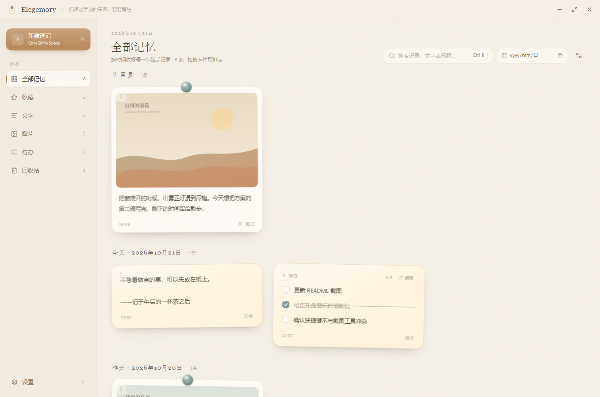

# Elegemory

**把掠过手边的东西，轻轻留住。**

Elegemory 是一款以剪贴板为入口、以时间轴为组织方式的 Windows 桌面速记应用。截图、文字、待办，按下快捷键就能收好；内容只保存在你的设备上，不需要账号，也不会上传云端。



## 下载

最新版本：**v0.5.0** · Windows 10 / 11 x64

| 文件 | 说明 |
| --- | --- |
| [elegemory.exe](https://github.com/chovypeng366/Elegemory/releases/download/v0.5.0/elegemory.exe) | 便携版，下载后直接运行，无需安装 |
| [Elegemory_0.5.0_x64-setup.exe](https://github.com/chovypeng366/Elegemory/releases/download/v0.5.0/Elegemory_0.5.0_x64-setup.exe) | NSIS 安装包 |
| [Elegemory_0.5.0_x64_en-US.msi](https://github.com/chovypeng366/Elegemory/releases/download/v0.5.0/Elegemory_0.5.0_x64_en-US.msi) | MSI 安装包 |
| [SHA256SUMS.txt](https://github.com/chovypeng366/Elegemory/releases/download/v0.5.0/SHA256SUMS.txt) | 文件校验值 |

也可以访问 [Releases](https://github.com/chovypeng366/Elegemory/releases/latest) 查看全部版本与更新说明。

- 需要 WebView2 运行时，Windows 10 / 11 通常已自带。
- 当前构建未做代码签名，首次运行时可能出现 SmartScreen 提示：点「更多信息」→「仍要运行」。
- 数据保存在 `%APPDATA%\com.elegemory.desktop`，升级应用不会清空现有记录。

## 功能

### 快速记录

- 全局快捷键 `Ctrl + Shift + Space` 唤出或收起速记窗口，可在设置中修改。
- 窗口弹出后自动聚焦输入框，支持中文输入法。
- 文字模式：`Enter` 收好，`Shift + Enter` 换行。
- 待办模式：每行一件事，`Ctrl + Enter` 收好。
- 支持 `Ctrl + V` 粘贴剪贴板图片，也支持拖入 PNG / JPEG / WebP 文件。
- 图片与说明文字可以组成同一条图文记录。
- `Esc` 收起窗口，输入内容和已附加图片会保存为草稿，下次打开继续。
- 保存后白板自动刷新，不需要手动同步。

### 记忆白板

- 左侧导航：全部、收藏、文字、图片、待办、回收站，带实时数量。
- 顶部关键词搜索匹配标题和全部文字内容，`Ctrl + K` 快速聚焦。
- 日期筛选按创建日期查找，可与关键词叠加使用；`Escape` 或清除按钮恢复全部日期。
- 按本地自然日逐日分组，标题显示为「今天 · 2026年10月21日 · 2条」「昨天 · 2026年10月20日 · 1条」，更早日期直接显示年月日；置顶记录单独成组。
- 在全部记忆、文字、图片、收藏、待办中，整张卡片可以直接拖拽排序；文字和图片可以互相换位，顺序会持久保存。
- 卡片使用自适应网格，保留纸张倾斜、悬停抬升与阴影变化。
- 待办卡片支持勾选，复选框与划线带动画；卡片菜单和详情面板都可以继续增删改待办。
- 详情面板默认居中显示，按住顶部标题区可以拖动，移动范围限制在窗口内。
- 支持修改标题、编辑文字、勾选待办、添加文字或待办、复制文字、复制原图。
- 删除记录先进入回收站，可恢复或永久删除；永久删除会同时清理不再被引用的图片文件。
- 关闭主窗口只会收起到系统托盘，不退出应用；托盘菜单可以打开白板、快速记录或完全退出。

### Memory Whisper

- 每次新增笔记或待办后，白板底部会出现一句简短的情绪文案，停留几秒后淡出，不堆叠、不弹窗。
- 文案内容、出现时机和一些小惊喜，留给使用过程中慢慢发现。

### AI 整理（可选）

- 在笔记详情中可以按需生成标题、生成摘要，或从文字中提取待办。
- 使用 DeepSeek API，需要自行填写 API 密钥；AI 功能默认关闭。
- 密钥保存在 Windows 凭据管理器，不写入数据库或前端代码。
- 只有点击 AI 按钮时，当前记录的文字才会发送给 DeepSeek；图片不会被上传，也不会在后台自动请求。
- 生成结果可以在保存前预览或编辑，是否采用由你决定。

### 外观与设置

- 纸张主题：暖纸、雾蓝、沙丘、陶土。
- 磁扣颜色：青瓷、赤陶、黄铜、墨蓝、鼠尾草、豆沙、石墨。
- 支持自定义背景图片与透明度。
- 可以修改速记快捷键，保存失败时会恢复旧快捷键。
- 拒绝没有修饰键的快捷键以及 `Ctrl+C` / `Ctrl+V`，避免全局劫持系统复制粘贴。
- 可以查看数据目录、记录数量、图片数量和回收站数量。
- AI 整理：保存或移除 DeepSeek API 密钥、测试连接；密钥存于 Windows 凭据管理器，默认关闭。
- 支持 `prefers-reduced-motion`，系统开启减弱动效时会跳过入场动画。

## 技术栈

| 层 | 技术 |
| --- | --- |
| 桌面框架 | Tauri 2 + Rust |
| 前端 | React 19 + TypeScript + Vite 8 |
| 样式 | Tailwind CSS 4 + 自定义设计变量 |
| 动画 | Motion for React |
| 状态 | Zustand |
| 数据库 | SQLite（rusqlite，内置迁移） |
| AI（可选） | DeepSeek API + Windows 凭据管理器 |
| 图标 | Lucide |

剪贴板使用 `tauri-plugin-clipboard-manager`，全局快捷键使用 `tauri-plugin-global-shortcut`，单实例使用 `tauri-plugin-single-instance`。数据库访问、图片落盘和文件清理由 Rust 命令层负责。

## 本地开发

### 环境要求

| 工具 | 版本 |
| --- | --- |
| Node.js | 24.x |
| npm | 11.x |
| Rust | 1.80+（`x86_64-pc-windows-msvc`） |
| Visual Studio Build Tools | 2022 + MSVC v143 |
| Windows SDK | 10.0.26100 或更高 |
| WebView2 Runtime | Windows 10 / 11 通常已自带 |

检查环境：

```bash
node -v && npm -v && rustc -V && cargo -V && rustup show
```

```powershell
& "C:\Program Files (x86)\Microsoft Visual Studio\Installer\vswhere.exe" -products *
```

如果 Rust 目标不是 MSVC 工具链：

```bash
rustup default stable-x86_64-pc-windows-msvc
```

### 安装与运行

```bash
npm install
```

```bash
npm run tauri dev
```

首次运行需要编译 Rust 依赖，通常需要几分钟；之后是增量编译。应用启动后会看到「记忆白板」，并在系统托盘常驻。

### 构建

```bash
npm run tauri build
```

构建产物位于 `src-tauri/target/release/bundle/`，包括 NSIS `.exe` 与 WiX `.msi`。首次构建需要联网下载 NSIS / WiX 工具链。

只生成 release 可执行文件、不打包安装包：

```bash
npm run tauri build -- --no-bundle
```

### 测试

```bash
npm test
```

```bash
cd src-tauri && cargo test
```

## 目录结构

```text
Elegemory/
├─ site/                        # 官网静态页面与截图
├─ src/
│  ├─ components/               # Logo、图标按钮、磁扣、Toast、确认框
│  ├─ features/
│  │  ├─ board/                 # 白板窗口、侧栏、顶部搜索、时间轴
│  │  ├─ capture/               # 速记窗口
│  │  ├─ notes/                 # 笔记卡片与详情面板
│  │  └─ settings/              # 设置弹窗与 Memory Whisper 设置
│  ├─ lib/                      # 日期工具、词库、低语引擎、资源 URL
│  ├─ services/                 # Tauri 命令、剪贴板、系统事件、开发预览数据
│  │  └─ ai/provider.ts         # DeepSeek Provider 与密钥状态
│  ├─ stores/                   # Zustand：笔记、界面、设置、低语、AI
│  ├─ styles/global.css         # 设计变量、纸张纹理、磁扣、按钮
│  └─ types/                    # TypeScript 数据模型
├─ src-tauri/
│  ├─ capabilities/default.json
│  ├─ migrations/
│  │  ├─ 001_init.sql
│  │  └─ 002_whisper.sql
│  ├─ src/
│  │  ├─ db.rs                  # 连接、迁移、查询组装
│  │  ├─ models.rs              # Serde 模型
│  │  ├─ tray.rs                # 托盘菜单
│  │  ├─ commands/
│  │  │  ├─ notes.rs            # 笔记 / 内容块 CRUD
│  │  │  ├─ assets.rs           # 图片校验、编码、落盘
│  │  │  ├─ settings.rs         # 设置与快捷键
│  │  │  ├─ whisper.rs          # 低语统计、历史与设置
│  │  │  ├─ ai.rs               # DeepSeek 请求、密钥与 AI 结果解析
│  │  │  └─ system.rs           # 窗口与退出
│  │  └─ lib.rs                 # 插件、迁移、快捷键、窗口生命周期
│  └─ tauri.conf.json
└─ README.md
```

## 数据存储

- SQLite 数据库：`%APPDATA%\com.elegemory.desktop\elegemory.db`
- 图片目录：`%APPDATA%\com.elegemory.desktop\assets\`
- 数据库只保存图片的相对路径，不保存 Base64。
- 迁移由 `schema_migrations` 表管理，启动时按版本执行。
- 时间统一使用 Unix 毫秒时间戳，界面按本地时区分组。

### 数据表

- `notes`：`id / type / title / created_at / updated_at / is_pinned / is_favorite / is_archived`
- `note_blocks`：`id / note_id / block_type / content / asset_id / sort_order / is_completed`
- `assets`：`id / relative_path / mime_type / width / height / size_bytes / created_at`
- `settings`：键值配置（快捷键、外观、Memory Whisper 偏好等）
- `daily_feedback_stats`：`workday_key / note_created_count / todo_created_count / daily_mood / updated_at`
- `whisper_history`：`id / phrase_id / category / note_type / shown_at / workday_key`

## 使用方式

1. 启动应用，按 `Ctrl + Shift + Space` 唤出速记窗口。
2. 输入文字；或截图后直接 `Ctrl + V`，图片会出现在窗口上方。
3. 按 `Enter`（待办模式按 `Ctrl + Enter`）收好，窗口自动收起。
4. 主窗口会按日期显示这张「纸张 / 照片」卡片。
5. 点击卡片打开详情；悬停卡片可以复制、收藏或删除。
6. 退出应用再打开，记录与图片仍然保留。

## 浏览器预览

不连接 Tauri 时（例如直接 `npm run dev` 在浏览器中打开），应用会使用 `src/services/mock.ts` 中的演示数据，方便调整界面。该模式仅用于开发预览，真实构建始终走 Tauri 命令，不提供任何伪装的系统能力。

- 白板预览：`http://localhost:1420/?window=main`
- 速记预览：`http://localhost:1420/?window=capture`

## 常见问题

**启动后白屏**

先查看 `npm run tauri dev` 的终端输出。常见原因是前端编译错误或端口 1420 被占用：

```bash
netstat -ano | findstr :1420
```

**首次运行被 SmartScreen 拦截**

当前安装包未做代码签名。确认文件来自本仓库的 Releases 后，点「更多信息」→「仍要运行」。

**快捷键没有反应**

`Ctrl + Shift + Space` 可能被输入法、PowerToys 或截图工具占用。打开应用设置改用其他组合，保存时会提示注册失败原因。

**粘贴图片没有反应**

确认剪贴板中确实是位图（Windows 截图工具、第三方截图工具或浏览器复制的图片）。可以使用速记窗口的「粘贴图片」按钮作为兜底，也支持直接拖入 PNG / JPEG 文件。

**图片在重启后不显示**

检查 `%APPDATA%\com.elegemory.desktop\assets\` 是否存在对应 PNG，以及数据库中 `assets.relative_path` 是否一致。应用通过 Tauri 资源协议读取该目录。

**关闭按钮没有退出应用**

这是托盘应用的预期行为。请使用托盘菜单「退出 Elegemory」或设置里的「退出 Elegemory」。

**安装包构建失败**

首次构建需要下载 NSIS / WiX。如果日志停在 `Downloading https://github.com/...` 或出现 `failed to bundle project: timeout: global`，通常是工具链下载超时，并非代码错误。可以先验证 release 可执行文件，网络恢复后再生成安装包：

```bash
npm run tauri build -- --no-bundle
```

## 后续计划

- macOS（Apple Silicon）适配与 Command 快捷键。
- 标签、每日回顾与更完整的导出能力。
- 明暗主题与更细腻的纸张材质。
- 图片资源回收站与孤儿资源清理。
- 可选的 AI 能力：标签推荐、批量整理与流式输出，默认关闭，由用户主动触发。

## 反馈

欢迎通过 [Issues](https://github.com/chovypeng366/Elegemory/issues) 反馈问题或提出建议。
